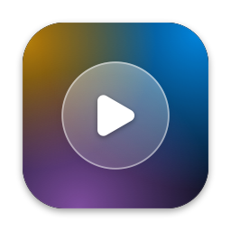
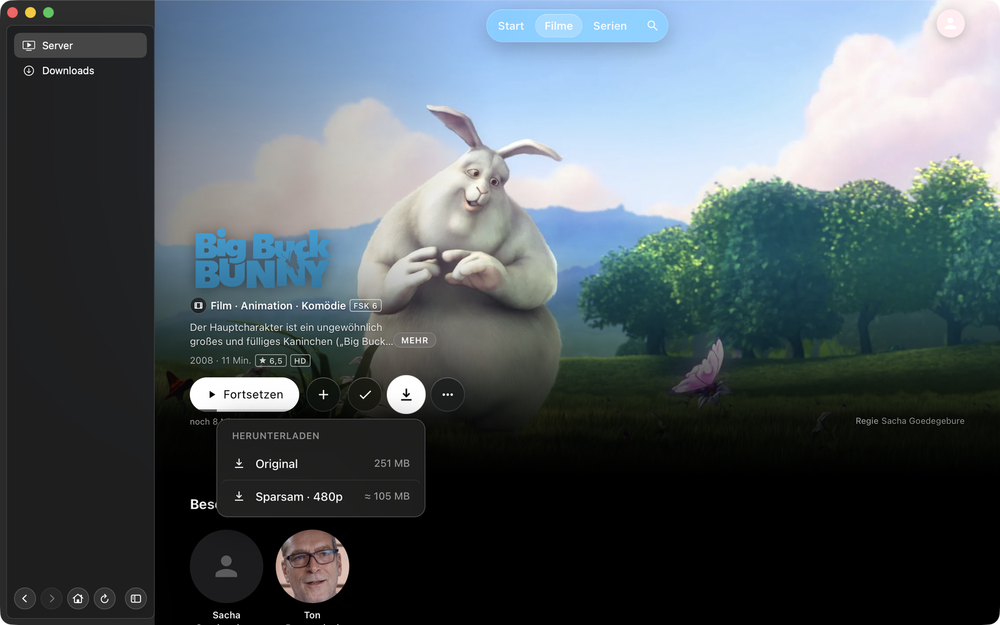
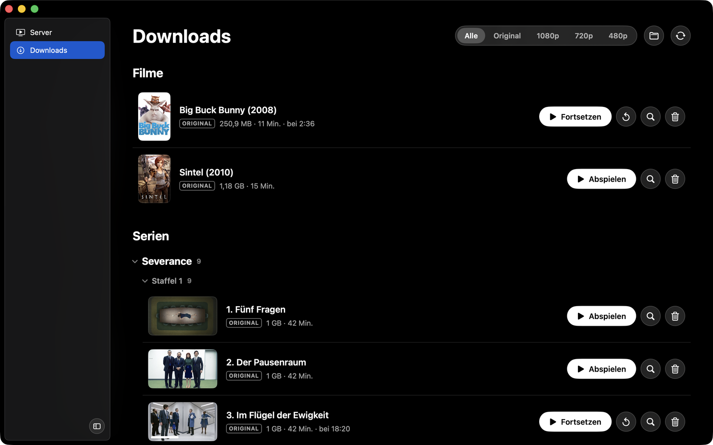

<p align="center"></p>

# JellyDesk

Ein nativer macOS-Client für [Jellyfin](https://jellyfin.org). Er zeigt die Weboberfläche des eigenen Servers unverändert und ergänzt sie um das, was im Browser fehlt: Titel herunterladen, offline abspielen und den Wiedergabestand später wieder mit dem Server abgleichen.

**Für Downloads, Offline-Wiedergabe und den eigenen Player muss auf dem Server das Plugin [Cinema Glass](https://github.com/derpfiff/cinema-glass) installiert sein.** Es blendet die Download-Knöpfe in der Weboberfläche ein, sobald es die App erkennt, und übergibt ihr die Titel – zum Laden wie zum Abspielen. Die Bildschirmfotos zeigen beide zusammen.






<sub>Die Bildschirmfotos stammen aus einer Testinstanz. Plakate und Texte kommen von TMDb und gehören den jeweiligen Rechteinhabern; sie sind nicht Teil dieses Projekts. „Big Buck Bunny“ und „Sintel“ © Blender Foundation, CC BY 3.0.</sub>

## Was die App kann

- **Weboberfläche des Servers** in einer `WKWebView`. Anmeldung, Cookies und LocalStorage bleiben erhalten. Die App schleust weder CSS noch JavaScript ein; Aussehen und Download-Knöpfe kommen vom Server.
- **Downloads** von Filmen, Folgen, Staffeln und ganzen Serien, in Originalqualität oder vom Server kleiner gerechnet (1080p, 720p, 480p). Höchstens zwei gleichzeitig, der Rest wartet in der Schlange.
- **Eigener Player auch für Streams**: Der Play-Knopf der Weboberfläche startet den Player der App. Die Datei kommt unverändert vom Server; der Server muss weder DTS noch TrueHD noch Bild-Untertitel umrechnen. Beginn, Stand und Ende werden dem Server gemeldet wie von jedem anderen Client, und nach einer Folge läuft die nächste der Warteschlange. Abschaltbar in den Einstellungen.
- **Vorschaubilder beim Spulen**: Über der Zeitleiste erscheint das Bild zur Stelle unter dem Zeiger, sofern der Server Vorschaubilder („Trickplay“) für den Titel erzeugt hat. Bei Downloads werden sie mitgeladen und funktionieren ohne Netz.
- **Offline-Player** auf Basis von libmpv: MKV und MP4 mit HEVC, H.264, DTS, TrueHD, E-AC3, eingebetteten und externen Untertiteln. Ton- und Untertitelspur lassen sich wählen; die Wahl wird je Titel gemerkt.
- **Vorspann wie auf dem Server**: Die App liest die Einstellungen des Plugins „Local Intros“, lädt dessen Intros einmalig und wählt vor jedem Start nach derselben Regel wie das Plugin.
- **Abgleich des Wiedergabestands**: Offline Gesehenes wird gemeldet, sobald der Server wieder erreichbar ist. Ist der Stand auf dem Server neuer, gilt der.

## Voraussetzungen

- macOS 14 oder neuer
- Xcode (gebaut mit Xcode 26) und [XcodeGen](https://github.com/yonaskolb/XcodeGen)
- Ein Jellyfin-Server, auf dem das Plugin [Cinema Glass](https://github.com/derpfiff/cinema-glass) installiert ist (für den eigenen Player bei Streams ab 1.3.0). Ohne das Plugin gibt es keine Downloads und damit auch keine Offline-Wiedergabe.

### Ohne Cinema Glass

Die App läuft auch mit einem Server ohne das Plugin, dann aber nur als Fenster für die Weboberfläche: stöbern und abspielen wie im Browser. Download-Knöpfe gibt es nicht, weil die Weboberfläche von Jellyfin die App nicht kennt. Der Menüpunkt „Herunterladen“ von Jellyfin selbst legt die Datei als gewöhnlichen Download im Ordner „Downloads“ ab – ohne Download-Liste, Offline-Player und Abgleich. Wer eine eigene Oberfläche hat, kann den Nachrichtenkanal auch selbst bedienen (siehe unten).

## Bauen

```sh
xcodegen generate
open JellyDesk.xcodeproj
```

Die Projektdatei wird aus `project.yml` erzeugt und nicht eingecheckt. Abhängigkeiten kommen über den Swift Package Manager.

Ohne weitere Einstellung wird lokal signiert. Der Schlüsselbund fragt dann nach jedem neuen Build einmal, ob die App auf ihren Eintrag zugreifen darf. Mit einem festen Zertifikat entfällt das: `Config/Local.example.xcconfig` nach `Config/Local.xcconfig` kopieren und Team und Zertifikat eintragen. Die Datei wird nicht eingecheckt.

## Einrichtung

Beim ersten Start fragt die App nach der Adresse des Servers und prüft sie. Ändern lässt sie sich in den Einstellungen.

Unverschlüsseltes HTTP erlaubt macOS der App für eigene Anfragen (Downloads, Abgleich) nur im Heimnetz: IP-Adressen, `.local` und Namen ohne Punkt. Die Weboberfläche selbst lädt auch über HTTP von anderen Adressen.

## Der Nachrichtenkanal

Die App meldet in der Web-Ansicht einen `WKScriptMessageHandler` mit dem Namen `atvDownload` an. Daran erkennt die Weboberfläche die App:

```js
window.webkit.messageHandlers.atvDownload.postMessage({
  type: "download", version: 1,
  url, filename, title, itemId, itemType, serverId, serverUrl,
  userId, accessToken, runTimeTicks, quality, estimatedBytes, container,
  seriesName, seasonNumber, episodeNumber, year, imageUrl, backdropUrl, positionTicks
})
```

Das vollständige Format steht in `docs/NATIVE-BRIDGE.md` von Cinema Glass. Einige Punkte zum Verhalten der App:

- Geladen wird genau die übergebene `url`. Die Qualität wählt man in der Weboberfläche.
- Das Token geht zusätzlich in der `Authorization`-Kopfzeile mit, weil neuere Server `api_key` in der Adresse ablehnen.
- Nachrichten werden nur aus dem Hauptdokument des eingestellten Servers angenommen, und `url` muss zum selben Server gehören wie `serverUrl`.
- Ein zweiter Kanal, `atvWindow`, überlässt der App das Vollbild: Cinema Glass (ab 1.2.3) leitet den Vollbild-Knopf des Web-Players, Doppelklick und die Taste F dorthin um, und die App schaltet ihr eigenes Fenster ins Vollbild. Das Vollbild von WebKit hängt die Web-Ansicht in ein zweites Fenster um, wobei das Bild springt. Im Plugin gehört dazu der Schalter „JellyDesk unterstützen“.
- Ein dritter Kanal, `atvPlay`, überlässt der App das Abspielen: Cinema Glass (ab 1.3.0) meldet sich bei Jellyfin-Web als Plugin an, das vor jeder Wiedergabe gefragt wird, und reicht die Warteschlange an die App. Antwortet sie mit `{ handled: true }`, endet die Wiedergabe im Web an dieser Stelle, und die App spielt die Dateien über `GET /Videos/{id}/stream?static=true`. Ist der Titel schon als Original heruntergeladen, spielt sie die lokale Datei. Live-TV, entfernte Trailer und alles, was kein Video ist, bleiben im Web-Player.
- `window.NativeShell` definiert die App bewusst nicht. Jellyfin-Web hielte die Seite sonst für die offizielle Mobil-App.

## Downloads

| Qualität | Verhalten |
|---|---|
| Original | Datei wie auf dem Server. Pausieren und Fortsetzen über Range-Anfragen, auch nach einem Neustart der App. |
| 1080p, 720p, 480p | Der Server rechnet während des Ladens um und liefert einen fortlaufenden MP4-Strom ohne Größenangabe. Der Fortschritt wird geschätzt; bricht die Verbindung ab, beginnt der Download von vorn. Davon läuft immer nur einer. |

Die Dateien liegen in der Sandbox der App unter `~/Library/Containers/<Bundle-ID>/Data/Library/Application Support/<Bundle-ID>/OfflineMedia`, geordnet nach `Filme/…` und `Serien/<Serie>/Staffel NN/…`. Untertiteldateien, die man neben ein Video legt, erkennt der Player von selbst.

Zugangsdaten stehen nie in einer Datei. `accessToken` und `userId` liegen im Schlüsselbund, ebenso die Fortsetzungsdaten angefangener Downloads, weil sie die Adresse samt Token enthalten. In den Metadaten (`library.json`) steht an Stelle des Tokens ein Platzhalter.

## Der Player

Der Player nutzt [MPVKit](https://github.com/mpvkit/MPVKit) (libmpv) mit Hardware-Dekodierung über VideoToolbox. Für MP4 und MOV, also die umgerechneten Downloads, gibt es zusätzlich einen Player auf Basis von AVKit; er lässt sich in den Einstellungen abschalten.

- Er spielt Downloads und, vom Play-Knopf der Weboberfläche gestartet, Titel direkt vom Server. Bei Streams führt der Server den Stand selbst: Die App meldet über `POST /Sessions/Playing`, `/Progress` und `/Stopped`. Spurwahl und Untertitel richten sich nach dem, was der Server für den Nutzer vorsieht.
- Die Wiedergabe setzt dort fort, wo sie zuletzt endete, auch wenn das im Browser war. „Von vorn abspielen“ setzt den Stand zurück.
- Die Position wird alle zehn Sekunden und beim Schließen gesichert. Ab 90 % gilt ein Titel als gesehen.
- Tastatur: Leertaste (Pause), Pfeile links/rechts (10 Sekunden), Pfeile hoch/runter (Lautstärke), F (Vollbild), M (Ton aus).
- Während der Wiedergabe bleibt der Bildschirm wach.

Für HDR-Material reicht der Player Farbraum und Metadaten an HDR-Bildschirme durch und rechnet sonst auf SDR um.

### Vorspann

Maßgeblich sind die Einstellungen des Plugins „Local Intros“ auf dem Server: der Schalter „nur vor Filmen“, die Standard-Intros und die Sonderregeln nach Tag, Genre, Studio und Datum mit Vorrang und Gewicht. Die App liest sie bei jeder Verbindung zum Server neu, sodass Änderungen dort auch offline gelten, sobald die App den Server einmal wieder gesehen hat.

Die Konfiguration darf nur ein Administratorkonto lesen. Ohne dieses Recht fragt die App je Titel den Server, welchen Vorspann er zeigen würde, und merkt sich die Antworten.

## Abgleich mit dem Server

Beim Start, bei jedem Netzwechsel und nach dem Schließen des Players meldet die App offene Stände:

- Position: `POST /UserItems/{itemId}/UserData?userId=…`
- Gesehen: `POST /UserPlayedItems/{itemId}?userId=…`

Ein Titel gilt erst nach erfolgreicher Antwort als abgeglichen. Die App prüft die Pfade gegen `/api-docs/openapi.json` des Servers und weicht bei älteren Servern auf die früheren Pfade aus; den Befund zeigen die Einstellungen.

## Berechtigungen

| Recht | Wozu |
|---|---|
| `com.apple.security.app-sandbox` | Die App läuft in der Sandbox. |
| `com.apple.security.network.client` | Ausgehende Verbindungen zum Server. |
| `com.apple.security.files.downloads.read-write` | Gewöhnliche Datei-Downloads aus der Weboberfläche landen im Ordner „Downloads“. |
| `NSAllowsLocalNetworking`, `NSAllowsArbitraryLoadsInWebContent` | Server im Heimnetz ohne HTTPS. |

## Aufbau

```
JellyDesk/
├── App/        Einstieg, Verdrahtung der Dienste
├── Models/     Nachricht der Weboberfläche, Metadaten eines Downloads
├── Services/   Downloads, Schlüsselbund, Jellyfin-API, Abgleich, Vorspann
├── Web/        Web-Ansicht und Nachrichtenkanal
├── Player/     Player-Schnittstelle, mpv- und AVKit-Player, Oberfläche
├── Views/      Hauptfenster, Download-Liste, Einstellungen
└── Support/    Pfade, Formatierung, Hinweise
Tools/make_icon.swift   zeichnet das App-Symbol
Config/                 Bundle-ID und Signatur
```

## Bekannte Grenzen

- Der AVKit-Player zeigt keine externen Untertitel.
- Streams im eigenen Player brauchen eine Leitung, die die Originaldatei trägt; eine geringere Datenrate kann nur der Web-Player anfordern (in den Einstellungen umschaltbar). SyncPlay und das Übertragen auf andere Geräte gibt es nur im Web-Player.
- Unter fünf Minuten Laufzeit merkt sich Jellyfin keine Position, sondern markiert den Titel beim Stoppen als gesehen; das gilt dann auch hier.
- Fortsetzungsdaten entstehen beim Pausieren und beim sauberen Beenden. Nach einem Absturz beginnt ein laufender Download von vorn.
- Die Übergangsanimationen innerhalb der Weboberfläche gehören zur Weboberfläche; die App greift dort nicht ein.

## Abhängigkeiten

- [MPVKit](https://github.com/mpvkit/MPVKit) mit libmpv, FFmpeg, libplacebo und MoltenVK. Eingebunden ist die LGPL-Variante.

Dieses Projekt ist kein offizielles Jellyfin-Produkt.
